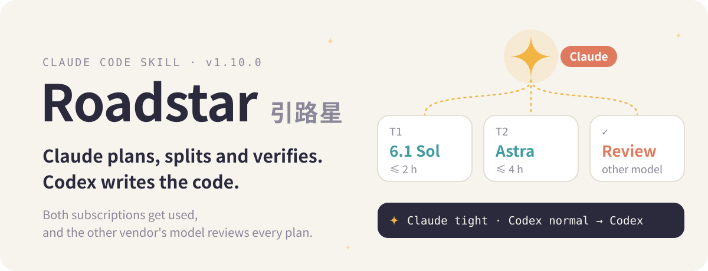
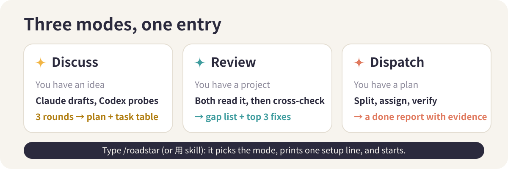

<p align="center">
  
</p>

<p align="center"><b>English</b> · <a href="./README.md">中文</a> · <a href="./README.ja.md">日本語</a></p>

<p align="center">
  
  
  
  
  
</p>

Roadstar is a Claude Code skill that turns your Claude session into a dispatcher for Codex. Claude writes the plan, splits the work into tasks of two hours or less, picks a model for each one, sends the coding to Codex, and verifies the result with a different model before it reaches you. If you pay for both Claude and ChatGPT, both subscriptions finally do real work.

## Used for real

Since 2026-10-04 the author has run it across four of their own projects (two apps, a website and a design tool):

- **17 runs**, from first idea to shipped builds
- **244 Codex sessions** dispatched: 130 on `gpt-6.1-sol`, 114 on `gpt-6-astra`
- **31 house rules**, each written the day a real run went wrong (a task that used 30% of the weekly quota in 7.5 hours, a merge that committed 846 screenshots, an app that passed every test and then ignored all taps once installed on a phone)

Every run starts with one line of setup and a live quota reading. The probe reads both accounts in just over a second and spends no quota:

```console
$ python3 skill/scripts/quota-status.py
Claude：5 小时 4%（18:49 重置）｜本周 82%（10-18 12:59 重置）｜Fable 2%（上限是周额度一半） → 紧
Codex：本周 24%（10-20 14:57 重置）｜重置卡 1 张｜credits … → 正常
```

Claude's quota reads "tight" (紧) and Codex's reads "normal" (正常), so this week the coding goes to Codex.

## What it fixes

**Two subscriptions, one doing the work.** Claude is the better organizer, so it keeps that job: planning, splitting, reviewing. Codex does the implementation. When Codex runs low, tasks go to Claude models by difficulty instead: Haiku for repetitive batch work, Sonnet for well-specified tasks, Opus for hard ones.

**A plan is never finished on the first pass.** Claude and Codex have different blind spots. In Discuss mode the strongest model from each vendor reviews the same plan. Every objection must cite a file, a line number or command output. Claude then accepts it, rejects it with a written reason, or leaves the call to you. Three rounds by default; it stops early when neither side finds anything new.

**Dispatching and checking work is exhausting.** Each task ships with completion criteria that can clearly fail, a model and reasoning effort, a script-enforced time limit, and a reviewer that is always a different model from the implementer. After merging, Claude re-runs the full test suite on the main branch itself; the implementer's "all tests pass" is only a reference.

<p align="center">
  
</p>

Small jobs (under an hour) skip all of this and get done directly. You can override any choice at any time with one sentence, such as "use more GPT this month", and the change holds for the whole run.

## Install

```bash
git clone https://github.com/Rurutia-Artemis/Roadstar.git
cd Roadstar && ./install.sh
```

`install.sh` symlinks `skill/` into `~/.claude/skills`, `~/.agents/skills` and `~/.codex/skills`. Open a new Claude Code session in any project and type `/roadstar`, or just say 「用 skill」.

The easiest way is to paste this repository's URL into Claude Code and say "install this". If you are an AI agent doing the install, follow these steps:

1. Clone into a permanent folder such as `~/Roadstar`. The installer links to that folder, so do not clone into a temp directory and do not move or delete it afterwards.
2. Run `./install.sh` from the repo root. It prints one `已链接` (linked) line per target.
3. Verify: `ls -l ~/.claude/skills/roadstar` points to the repo's `skill/`, and `bash skill/scripts/tests/run.sh` ends with `PASS 32 checks`.
4. Check Codex: `codex --version` should be 0.160 or later (install with `npm i -g @openai/codex@latest`), and `codex login status` should say logged in. Logging in opens a browser, so ask the human to run `codex login` themselves. Without Codex, Roadstar still runs in Claude-only mode.
5. Tell the human to start a new Claude Code session (skills load at session start) and say 「用 skill」 or `/roadstar`.

Requirements:

- Claude Code (built and used on the Max plan)
- [Codex CLI](https://github.com/openai/codex) 0.160 or later, signed in with a ChatGPT account: `npm i -g @openai/codex@latest`
- macOS, bash and Python 3; the scripts use only the standard library

No Codex? It falls back to a Claude-only mode: an Opus subagent reviews the plan (marked as same-vendor in the notes) and Haiku, Sonnet or Opus does the work. This mode exists but has not been through a complete real run yet.

## Repository

```
skill/        SKILL.md, references/, scripts/ (quota probe, review, dispatch, stub tests)
docs/         records of the skill's own upgrades; runs in other projects live in their docs/roadstar/
install.sh    symlinks the skill into Claude Code and Codex
CHANGELOG.md  one entry per change, with what was and was not verified
```

## Disclaimer

- Personal project. Not affiliated with or endorsed by Anthropic or OpenAI; Claude, Claude Code, Codex and ChatGPT are trademarks of their owners.
- It runs on your own subscriptions and spends your Claude and Codex quota. A Discuss run typically uses both sides for 30 to 60 minutes.
- Codex is always launched with an explicit sandbox: `read-only` for reviews, workspace-write for implementation. The one exception, UI acceptance that needs a simulator, uses full access, with strict boundaries fixed in the task brief; read those briefs before you approve them.
- Model names, quota tiers and prices reflect the author's setup in October 2026. Adjust `skill/references/models.md` for yours.
- The skill itself and its records are written in Chinese.
- Provided as is, under the [MIT License](LICENSE).

---

<p align="center"><sub>README visuals follow <a href="https://github.com/oil-oil/beautify-github-readme">beautify-github-readme</a>. Formerly <i>roundtable</i> (2026-09-24 to 10-04).</sub></p>
