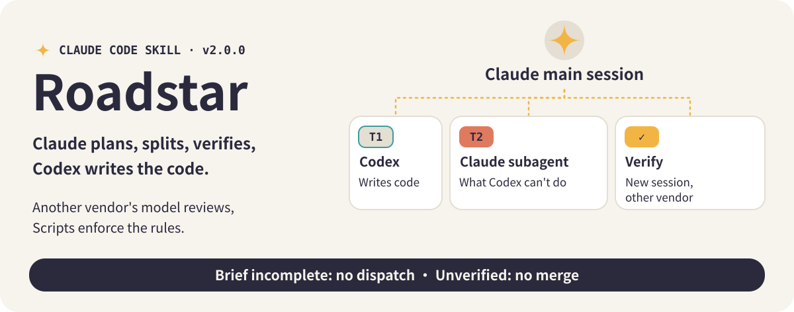
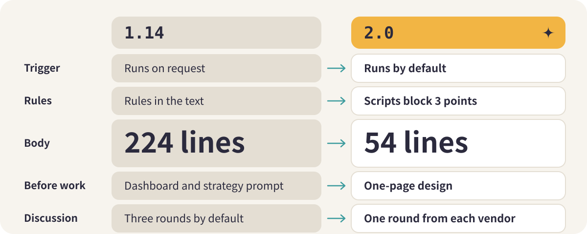
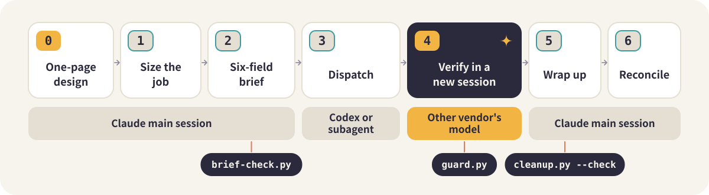
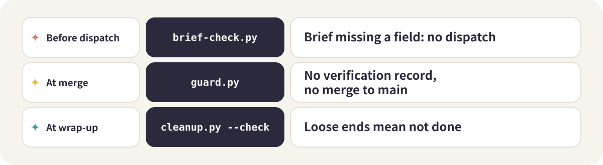
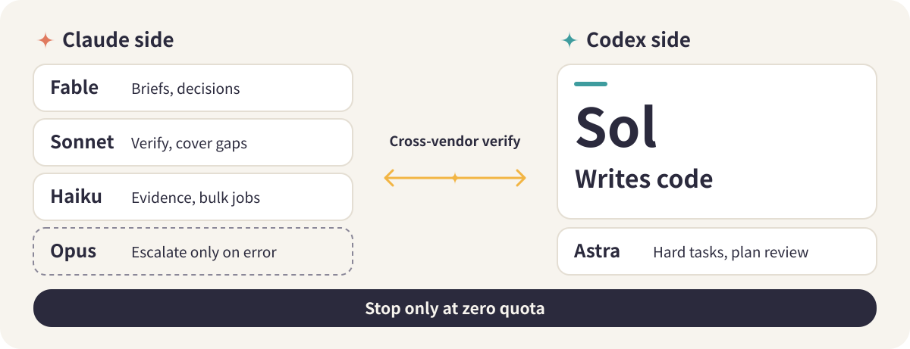

<p align="center">
  
</p>

<p align="center"><a href="./README.md">中文</a> · <b>English</b> · <a href="./README.ja.md">日本語</a></p>

<p align="center">
  
  
  
  
  
</p>

# Roadstar

Roadstar is a Claude Code skill. The main Claude session plans, splits the work and verifies it. Codex writes the code. Then a different session, on a model from the other vendor, comes back and hunts for errors. Any job that takes more than an hour runs through six steps automatically inside your project session. You do not have to name the skill.

After you install it, you keep asking for things in your project as usual. When a request is bigger than an hour, Claude first writes a one-page design. It then splits the job into six-field task briefs and hands them to Codex or to Claude subagents. A fresh session, on a model from the other vendor, re-runs the verification commands on each result. Nothing merges into the main branch until that check has passed. Small jobs that fit in an hour are done directly, with no process.

You get two things. Each subscription's quota covers its own kind of work, so your Claude quota is kept for directing the work and exercising judgment. And every deliverable carries a review record from the other vendor's model, stored in the repo where you can look it up later.

| What you need | How Roadstar runs it | What you get |
|---|---|---|
| A small job, an hour or less | No process. Claude just does it. | One turn, no extra files |
| A medium job, over an hour | Half-page design, one task brief, one executor, verification in a new session | The change plus a verification record |
| A large job or a new project | Full-page design, split into several task briefs of two hours or less, dispatch table shown to you first | Each task has its own brief and verification record, then merges into the main branch |
| Just an idea, or a retrospective | Say "open a roundtable" (开圆桌). Both vendors each give one round of lists and you pick | A `plan.md`, or a list of gaps you have chosen |

## What changed in 2.0

1.14 was a long process that ran only when you named it, with a 224-line body. 2.0 was rewritten on November 3. The two weeks after that added another round of fixes from real projects and simulated runs.

<p align="center"></p>

1. **It runs by default, with no trigger words to remember.** In a project session, any job that takes more than an hour goes through the six steps on its own. 1.14 needed you to say "用 skill" ("use the skill").
2. **Scripts enforce the rules. The model does not have to remember to read them.** If a task brief lacks a field, `brief-check.py` makes `dex-exec.sh` exit with code 2 and the task is not dispatched. If there is no verification record, `guard.py` refuses the merge into the main branch. At wrap-up, if `cleanup.py --check` finds unfinished work, the job does not count as done.
3. **The body fits in two screens.** `skill/SKILL.md` went from 224 lines and 18152 characters in 1.14 to 54 lines and 4514 characters. The dashboard, strategy question, minutes and completion report screens are all removed. The full 1.14 text is kept in `skill/references/SKILL-v1.14.md` so you can go back at any time.
4. **Write a one-page design before starting.** Medium jobs get half a page, large jobs and new projects get a full page, saved as `design.md` in the job's directory. Questions only you can answer are listed together, each with a recommended answer, and replying "好" ("OK") accepts all the recommendations. For jobs that need your approval, the approval record is taken by a session hook from your own words in that turn. An approval the model writes by hand does not count.
5. **Verification uses a new session and the other vendor, and looks specifically for quietly lowered standards.** Sonnet verifies what Codex wrote, and Codex verifies what Sonnet wrote. The verification record has a section called the "five checks for lowered standards" (降标准五查): a lowered threshold, a skipped or deleted test, a disabled check, a stub or half-finished piece left behind, and a newly added exception. At merge time `guard.py` checks that section by file path.
6. **It cuts its losses, and the estimates get recalibrated.** It stops when one check fails three times in a row, when the work spins in place, or when 90% of the time is used up. Finished work is kept, and only what did not pass goes to a model one tier up to finish. The cap is twice the estimated time. The estimate comes from an experience table, and `dispatch-stats.py --calibrate` rewrites that table from the real durations on your machine.
7. **Fewer wrong blocks.** On November 17 and 18, checks against real usage records, plus simulated runs on a synthetic project (14 kinds of deliberate mistakes, 2 of them missed), turned up a batch of false blocks and misses. Five checks were narrowed to prevent false blocks, and two cases that should have been blocked are now caught. See the November 17 and 18 entries in `CHANGELOG.md`.

## Watch it block once

The three blocks below are the original output of a real run in a throwaway demo project, with the temp directory in the paths replaced by `demo`. The output is reproduced as printed, with a short English explanation after each block. In the first, the task brief is missing the "执行环境" (execution environment) field. `brief-check.py` refuses it and exits with code 2:

```console
$ python3 skill/scripts/brief-check.py docs/roadstar/2026-11-20-demo/rounds/exec-T1-request.md
任务书不合格，派不出去：
  - 缺「执行环境」一栏
  按 references/task-brief-template.md 补齐再派；真急可 BRIEF_CHECK=0（会记下）。
$ echo $?
2
```

The brief fails the check and cannot be dispatched, because the "execution environment" field is missing. Fill in the fields following `references/task-brief-template.md` and dispatch again. If you are in a real hurry, `BRIEF_CHECK=0` skips the check, and the skip is logged.

In the second, the demo repo has the checks installed with `install-guard.sh`. A commit on the feature branch carries a `Roadstar-Task` trailer but there is no `check-T1.md`, so `git merge --no-ff` is blocked:

```console
$ git merge --no-ff feat/export -m "merge feat/export"
拦下了：这些任务还没有验收记录，不能合并
- docs/roadstar/2026-11-20-demo/T1：demo/docs/roadstar/2026-11-20-demo/rounds/check-T1.md
怎么办：先验收，再在上面的路径写下非空验收记录，然后重试 git merge --no-ff。
Not committing merge; use 'git commit' to complete the merge.
```

The merge is blocked because task T1 has no verification record yet. The hook lists the path where the record must be written. Verify first, write a non-empty record at that path, then retry `git merge --no-ff`. The last line is Git's own message.

In the third, `cleanup.py --check` runs during wrap-up of the same job. The work has not been merged into the main branch, and the exit code is 1:

```console
$ python3 skill/scripts/cleanup.py --project demo --check --plan-dir docs/roadstar/2026-11-20-demo
收工检查：还有 1 项没收完
没合并：T1（docs/roadstar/2026-11-20-demo）在分支 feat/export 上，1 个提交
$ echo $?
1
```

The wrap-up check reports 1 item still open: T1 has not been merged. It sits on branch `feat/export` with 1 commit. The command exits with 1, so the job is not done.

## The six steps

<p align="center"></p>

Three roles appear below. The Chair (主席) is you: you set the goal, make the calls and can cut in at any time. Argo is the main Claude session. It only produces task briefs, rulings, dispatch records and a few lines for you. Dex is Codex. Dex does the work assigned to it and reviews the other side's work. It does not split jobs or decide anything.

0. One-page design. Half a page for medium jobs, a full page for large ones. If it needs your approval, it waits for that before going on.
1. Size the job. A small job is done directly. A medium job gets one task brief and one executor. A large job is split into several tasks, each with one goal and two hours or less, and you get a dispatch table to look over.
2. Write the six-field task brief: goal and what done looks like, modules involved, what must not be touched, execution environment, verification commands and expected output, and resource limits and stop-loss.
3. Dispatch. Well-specified implementation goes to Codex. Work with an unknown root cause, or work Codex cannot do, goes to a Claude subagent. Every line of work gets a time cap and a progress file.
4. Verify in a new session. A clean session gets only the task brief, the change and the test results. It re-runs the verification commands and writes `check-T<n>.md`.
5. Wrap up. Fill in the actual time in `.meta`, run `cleanup.py` to take stock, and commit.
6. Reconcile. The gap between estimate and actual time, the first-pass verification rate and the number of reworks are then used to revise the estimate table.

## The three points where scripts block

<p align="center"></p>

The first is before dispatch. `dex-exec.sh` runs `brief-check.py` before it dispatches, and if any of the six fields is missing it exits with code 2. For medium or larger jobs, tasks that write files must also cite the design page, and jobs that need approval must have an approval record.

The second is at merge. `guard.py` is installed as the project's Git hook through `skill/scripts/install-guard.sh <project-root> --claude`. A `git merge --no-ff` without the matching `check-T<n>.md` is blocked. A commit that changes a module entry point without updating `docs/模块地图.md` (the module map) is blocked too. It identifies the job from the `Roadstar-Task:` trailer in the commit message. If a commit has no trailer, it only warns and does not block.

The third is at wrap-up. `cleanup.py --check --plan-dir <job-directory>` looks for unfinished work in the job (unmerged tasks, leftover copies). If it finds any, it exits with 1 and the job does not count as done. All three scripts are in the repo and work as soon as you install them.

One more hook automatically records unfinished work as a to-do when a session ends. It lives in the author's own environment and is not in the repo, so installing Roadstar does not give you that one.

## Who does what, and which model

<p align="center"></p>

- Fable only writes task briefs and makes calls in the main session.
- Codex has two tiers. Sol is the workhorse for writing code: well-specified implementation, changes and refactors go to it first. Astra takes hard tasks and plan review.
- Sonnet does what Codex cannot (web access, evidence gathering, checks after deployment), verifies the code Codex wrote, and writes the code when Codex's quota hits zero.
- Haiku handles read-only evidence gathering and mechanical bulk work. Its API price is about one twentieth of Sonnet's.
- Opus steps in only in three cases: Sonnet got something wrong or missed something, even once; the two sides disagree and Argo cannot decide even after reading the changes; or Codex is at zero and a mistake on this job would be costly. Every escalation comes with one sentence on why.

The split table is `skill/references/dispatch-table.md`. Exact model IDs and prices live in `skill/references/models.md`. When a new model comes out, you edit that one file.

Roadstar stops only when quota hits zero. When that happens it tells you once, and you top up or reset. Until then it neither stops dispatching nor asks. `skill/scripts/quota-status.py` costs no quota and shows how much of each side you have used so far.

If you subscribe to only one vendor, the answer depends on which one. With only a Claude subscription you can run in single-vendor mode: each row of the split table keeps just the Claude cell, a Fable subagent reviews plans, and Roadstar says so outright: "本场单家模式，审稿同家" (this job is in single-vendor mode, the reviewer is from the same vendor). The reviewer is still a different model from the executor. You only lose the cross-vendor layer of error-hunting. With only a GPT subscription it does not work, because Argo, the main session, must be Claude.

## What it looks like in use

Each job takes one directory in the project, `docs/roadstar/<date>-<slug>/`, and there is a standing boundary file at `docs/roadstar/_common.md`.

```text
docs/roadstar/2026-11-20-export-button/
  design.md                    one-page design (required from medium jobs up)
  plan.md                      large jobs only
  ledger.md                    rulings, disputes, dispatch log
  rounds/
    exec-T1-request.md         task brief
    exec-T1.md                 what the executor handed back
    exec-T1.meta               model, effort, estimate and actual time
    exec-T1.progress           one line per attempt at a check
    check-T1.md                record of the new-session verification
```

Write the task brief following `skill/references/task-brief-template.md`. Below is the skeleton of the first field, with the angle brackets marking what you fill in.

```markdown
# T1 · <one plain-language task name>
设计页：docs/roadstar/<日期>-<slug>/design.md

## 目标与做完的样子
<一个目标。完成线拆成 C1 … Cn，每项一条能失败的数字或可观测条件，附测法>
```

The skeleton is in Chinese because the template is. "设计页" is the design page path, and "目标与做完的样子" is the goal and what done looks like. The angle-bracket line says: one goal; split the finish line into C1 … Cn, each a numeric threshold or observable condition that a check can fail, plus how to test it.

The other five fields are modules involved, what must not be touched, execution environment, verification commands and expected output, and resource limits and stop-loss. A field you cannot fill in gets "待定：缺什么信息" (pending: what information is missing). A brief with pending items is not dispatched.

## Open a roundtable

When you have only an idea, or want a retrospective on an existing project, say "开圆桌", "探讨", "复盘" or "全面 review" (open a roundtable, discuss, retrospective, full review). In discussion, Argo and Dex each give one short list covering side features, settings, spin-off features and engineering risks. You pick, then `plan.md` is written. In a retrospective, each side reads the project once, read-only, and gives its own list of gaps. Argo merges them, and you choose which ones go into step 1. Details are in `skill/references/modes.md`.

## Install and requirements

```bash
git clone https://github.com/Rurutia-Artemis/Roadstar.git
cd Roadstar && ./install.sh
```

`install.sh` symlinks `skill/` to `~/.claude/skills/roadstar`, `~/.agents/skills/roadstar` and `~/.codex/skills/roadstar`, and removes the old symlinks from its predecessor, roundtable. After installing, start a new Claude Code session. Ask for a job longer than an hour in a project and it follows the process, or you can type `/roadstar`.

> [!TIP]
> The easiest way to install is to hand this repo's address to Claude Code and say "install this for me".

If you are an AI doing the install, follow these steps:

1. Clone into a directory that will stay, such as `~/Roadstar`. The symlinks point there, so do not move or delete it after installing.
2. Run `./install.sh` in the repo root. Each target prints one line saying it is linked ("已链接").
3. Verify: `ls -l ~/.claude/skills/roadstar` points to `skill/` in the repo, and `bash skill/scripts/tests/run.sh` exits with 0.
4. Check Codex: `codex --version` must be 0.160 or later (if not, `npm i -g @openai/codex@latest`), and `codex login status` must show a logged-in account. Login opens a browser, so ask the user to run `codex login` themselves. Without Codex, use single-vendor mode.
5. To install the merge and commit checks in a project, run `skill/scripts/install-guard.sh <project-root> --claude`, then tell the user to restart the Claude Code session.

You need Claude Code. For the two-vendor flow you also need [Codex CLI](https://github.com/openai/codex) 0.160 or later, logged in with a ChatGPT account. You also need macOS, bash and Python 3. The scripts use only the standard library.

> [!IMPORTANT]
> The install is a symlink. If you delete or move the repo folder, the skill stops working. Approval records are written by a hook tool in the author's own environment, and this repo does not include it. In any other environment, a job that needs approval is blocked at the `brief-check.py` step for lack of a record. Set `ROADSTAR_DESIGN_CHECK=0` to skip the design-page check (the skip is logged).

## Layout

`skill/` holds `SKILL.md`, `references/` (templates, the split table, the model table) and `scripts/` (checks, dispatch, the quota probe, stub tests). `docs/` holds this skill's own job records, the module map and the notes on data reporting. `install.sh` makes the symlinks. `CHANGELOG.md` gets one entry per change, saying what was verified and what was not.

## Data reporting (optional, off by default)

`skill/scripts/telemetry.py` is still there and is off by default. It turns on only when you run `python3 skill/scripts/telemetry.py enable`. Once on, at the end of each job it uses your local `gh` to open an Issue in the public repo [roadstar-data](https://github.com/Rurutia-Artemis/roadstar-data) from your GitHub account. The Issue holds 12 fixed fields (job category, model, effort, whether it finished, time used, quota difference and so on). It has no code, paths, project names or free text. A copy of the exact text is kept on your machine before it is sent. Run `telemetry.py disable` or set `ROADSTAR_TELEMETRY=0` to turn it off, and `status` shows the current state. The field list and format are in `docs/社区数据回传.md`.

## Disclaimer

- A personal project. It is not affiliated with or endorsed by Anthropic or OpenAI. Claude, Claude Code, Codex and ChatGPT are trademarks of their respective owners.
- It runs on your own subscriptions and spends your Claude and Codex quota.
- It does not add `--dangerously-*` flags by default. Codex reviews run `read-only` and execution runs with a writable workspace. `danger-full-access` is used only for verification that has to start a simulator or open a port, with the limits fixed in the task brief, so look them over before you approve.
- Provided as is under the [MIT license](LICENSE).

---

<p align="center"><sub>The README images follow the method of <a href="https://github.com/oil-oil/beautify-github-readme">beautify-github-readme</a>. The predecessor was called roundtable (2026-09-24 to 10-04).</sub></p>
