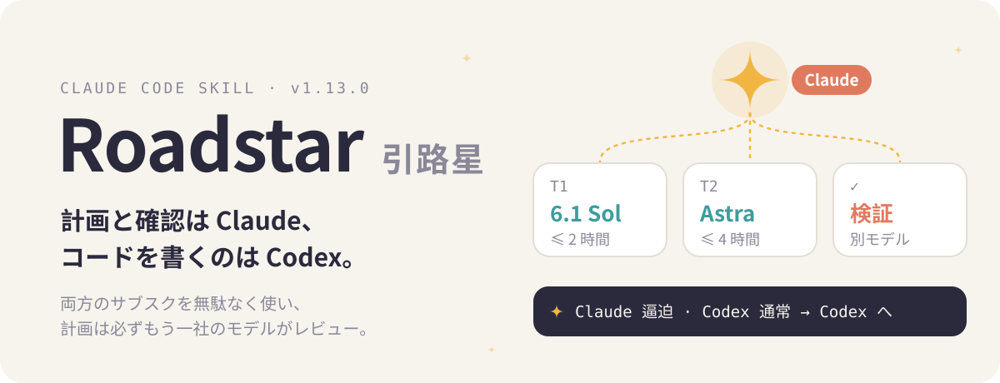
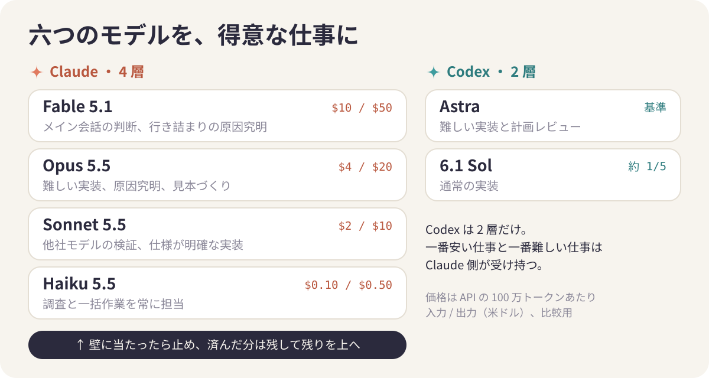
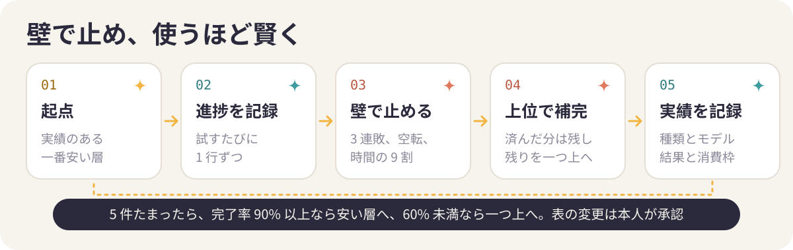

<p align="center">
  
</p>

<p align="center"><a href="./README.en.md">English</a> · <a href="./README.md">中文</a> · <b>日本語</b></p>

<p align="center">
  
  
  
  
  
</p>

Roadstar は、Claude Code のメインセッションを Codex の指揮役にする skill です。Claude が計画を書き、作業を 2 時間以内で終わる単位に切り分け、タスクごとにモデルを選び、実装を Codex に渡します。実装結果は担当したモデルとは別のモデルで検証し、合格したものだけが手元に届きます。Claude と ChatGPT の両方を契約している人なら、二つのサブスクがどちらもきちんと働くようになります。

<p align="center"></p>

作者は 2026-10-04 から自分の 4 つのプロジェクト（アプリ 2 本、Web サイト 1 つ、デザインツール 1 つ）で使っています。

<p align="center"></p>

31 のルールは、どれも実際の失敗のその日に書き足したものです。7 時間半で週間利用枠の 30% を消費したタスク、スクリーンショット 846 枚をコミットしてしまったマージ、全テストに合格したのにスマートフォンに入れると画面がまったくタップに反応しなかったアプリなどです。

毎回、最初に設定とその時点の利用枠の状況を 1 行で報告します。両サービスの状況は 1 秒強で取得でき、利用枠は消費しません。

```console
$ python3 skill/scripts/quota-status.py
Claude：5 小时 4%（18:49 重置）｜本周 82%（10-18 12:59 重置）｜Fable 2%（上限是周额度一半） → 紧
Codex：本周 24%（10-20 14:57 重置）｜重置卡 1 张｜credits … → 正常
```

Claude の利用枠は「逼迫」（紧）、Codex は「通常」（正常）なので、今週の実装は Codex に回します。出力は中国語です。

<p align="center"></p>

### サブスクが二つあるのに、働いていたのは片方だけ

整理と指揮が得意な Claude には計画づくりから割り振り、レビューまでを任せ、実装は Codex が担当します。Claude 側の 4 つのモデルにもそれぞれ決まった持ち場があります。調査や一括作業は Haiku 5.5 が常に受け持ち、API 価格は Sonnet の約 20 分の 1 です。Codex が書いたコードは Sonnet が他社の目で検証します。難しい実装は利用枠を見て Opus か Astra に回し、Fable はメイン会話に残って、二度試しても解けない問題が出たときだけ動きます。

<p align="center"></p>

### 計画は一回では詰め切れない

Claude と Codex は見落とすところが違います。計画検討モードでは両社の最上位モデルが同じ計画をレビューし、指摘には必ずファイルと行番号、またはコマンド出力を添えます。Claude は一件ずつ採用するか、理由を書いて退けるか、本人の判断に回します。通常は 3 ラウンドで、双方から新しい指摘が出なくなれば早めに終わります。

計画検討は、設計の話から始めません。主な機能は分かっていても、その周りにどんな設定や選択肢があり、そこからどんな機能が広がるかまでは、作りたい本人にも見えていないことが多いからです。まず両社のモデルがそれぞれ十の観点（初回の利用、毎日の利用、設定、エラーと例外、通知と継続、共有、データ、派生機能、課金、アクセシビリティと多言語）から機能を出し、誰のためか、使う人に何が起きるかを一件ずつ書きます。Claude が二つを一つの表にまとめ、Codex が抜けと作り込みすぎを点検し、本人は「今回作る」「次回」「作らない」に振り分けるだけです。設計の議論はそのあとに始まります。

### 作業の割り振りと確認がとにかく疲れる

各タスクには、達成できたかどうかを明確に判定できる完了条件、モデルと推論強度、スクリプトが強制する時間上限、そしてレビュー担当が付きます。レビューには、実装を担当したモデルとは必ず別のモデルを使います。マージ後は Claude 自身がメインブランチで全テストを流し直し、実装側の「全部通りました」は参考扱いです。

### 行き詰まったら早めに止め、残りだけを上の層へ

どのタスクも、検証項目を試すたびに進捗を 1 行ずつ残します。同じ項目で 3 回続けて失敗したとき、新しい合格がしばらく出ないとき、時間上限の 9 割を使い切ったときは、その場で止めます。合格した分はそのまま残し、残った項目だけを一つ上の層に渡します。Claude 側なら Haiku から Sonnet、Opus、Fable の順、Codex 側なら Sol から Astra です。最初からやり直すことはありません。

### どの仕事をどのモデルに任せるか、使うほど分かってくる

割り振りのたびに、作業の種類、モデル、結果、消費した枠を記録します。同じ種類が 5 件たまると `dispatch-stats.py` が集計し、安い層でも 9 割以上終わるなら起点を下げ、今の層で 6 割に届かないなら一つ上げるよう提案します。変更は毎回、承認を得てから反映します。Claude だけで使うときも同じ仕組みです。

<p align="center"></p>

<p align="center">
  
</p>

1 時間以内で終わる小さな作業はこの流れを使わず、その場で片付けます。段取りは一言でいつでも変えられます。たとえば「今月は GPT を多めに」と言えば、その実行のあいだずっとそれに従います。

<p align="center"></p>

```bash
git clone https://github.com/Rurutia-Artemis/Roadstar.git
cd Roadstar && ./install.sh
```

`install.sh` は `skill/` を `~/.claude/skills`、`~/.agents/skills`、`~/.codex/skills` にシンボリックリンクします。任意のプロジェクトで Claude Code のセッションを開き直し、`/roadstar` と入力するか「用 skill」と言えば始まります。新しい版が出ると最初の 1 行で知らせるので、「更新 Roadstar」と言えば最新版に更新されます。

> [!TIP]
> いちばん手軽なのは、このリポジトリの URL を Claude Code に渡して「インストールして」と頼む方法です。

インストールを担当する AI は次の手順に従ってください。

1. `~/Roadstar` のような長く残すフォルダにクローンします。インストーラーはこのフォルダへリンクを張るので、一時ディレクトリには置かず、インストール後も移動・削除しないでください。
2. リポジトリのルートで `./install.sh` を実行します。リンク先ごとに「已链接」（リンク済み）が 1 行ずつ表示されます。
3. 確認：`ls -l ~/.claude/skills/roadstar` がリポジトリの `skill/` を指していること、`bash skill/scripts/tests/run.sh` の最後が `PASS 32 checks` であること。
4. Codex の確認：`codex --version` が 0.160 以上（なければ `npm i -g @openai/codex@latest`）、`codex login status` がログイン済みであること。ログインにはブラウザが開くので、`codex login` はユーザー本人に実行してもらってください。Codex がなくても Claude だけのモードで動きます。
5. Claude Code のセッションを開き直すようユーザーに伝えます（skill はセッション開始時に読み込まれます）。そのあと「用 skill」と言うか `/roadstar` と入力すれば始まります。

必要なもの：

- Claude Code（作者は Max プランで開発・運用）
- [Codex CLI](https://github.com/openai/codex) 0.160 以上、ChatGPT アカウントでログイン済み：`npm i -g @openai/codex@latest`
- macOS、bash、Python 3（スクリプトは標準ライブラリのみ）

Codex がなくても Claude だけのモードで動きます。計画のレビューは Fable のサブエージェントが担当し（記録には同じ会社のモデル同士と明記）、実装は作業内容に応じて Haiku、Sonnet、Opus が担当します。このモードは実装済みですが、実際のプロジェクトで最初から最後まで通したことはまだありません。2026-10-14 に加えた Claude 4 層の常時運用、早めの停止、実績からの学習も同じくまだ本番で通していません。過去の記録の多くには作業の種類が入っていないため、実績表が役に立つまでには何回か実行を重ねる必要があります。

## 構成

```
skill/        SKILL.md、references/、scripts/（利用枠の取得、レビュー依頼、タスク割り当て、スタブテスト）
docs/         この skill 自身のアップグレード記録。他プロジェクトでの実行記録は各プロジェクトの docs/roadstar/ に
install.sh    skill を Claude Code と Codex にリンク
CHANGELOG.md  変更ごとに一件、検証済みと未検証を明記
```

## 免責事項

- 個人のプロジェクトです。Anthropic および OpenAI とは関係がなく、承認も受けていません。Claude、Claude Code、Codex、ChatGPT は各社の商標です。
- 利用者自身のサブスクで動き、Claude と Codex の利用枠を消費します。計画検討モード 1 回で、通常は両サービスを並行して 30〜60 分ほど使います。
- Codex は毎回サンドボックスを明示して起動します。レビューは `read-only`、実装ではワークスペースへの書き込みを許可するサンドボックスを使います。例外はシミュレーターが必要な UI の受け入れ確認だけで、このときはフルアクセスで起動し、厳密な作業範囲をタスク指示書に定めます。承認する前に指示書に目を通してください。
- モデル名や利用枠の区分、価格は 2026 年 10 月時点の作者の環境に基づきます。ご自身の環境に合わせて `skill/references/models.md` を書き換えてください。
- skill 本体と記録は中国語で書かれています。
- [MIT ライセンス](LICENSE)のもと、現状のまま提供します。

---

<p align="center"><sub>README のビジュアルは <a href="https://github.com/oil-oil/beautify-github-readme">beautify-github-readme</a> の手法で制作。旧名は roundtable（2026-09-24〜10-04）。</sub></p>
