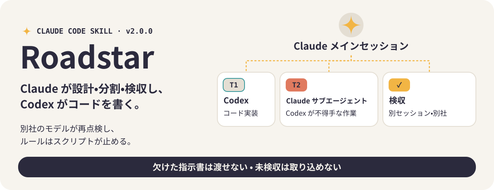
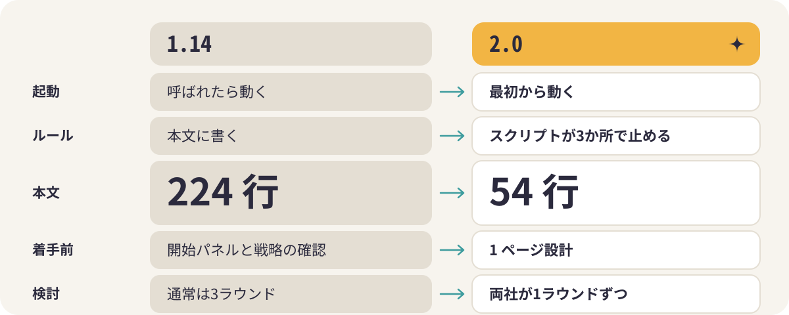
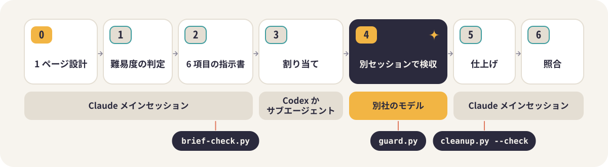
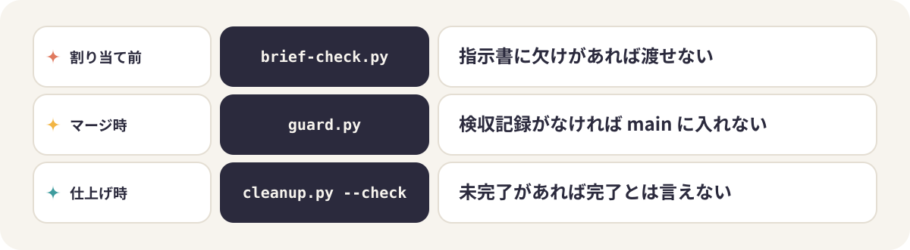
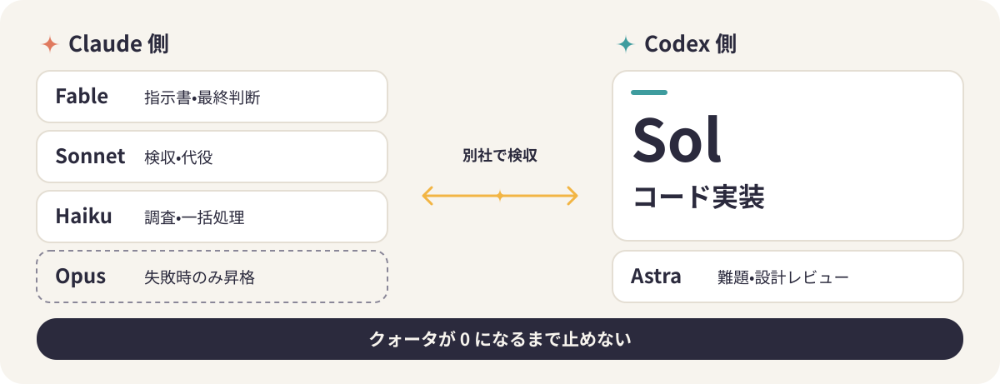

<p align="center">
  
</p>

<p align="center"><a href="./README.md">中文</a> · <a href="./README.en.md">English</a> · <b>日本語</b></p>

<p align="center">
  
  
  
  
  
</p>

# Roadstar（引路星）

Roadstar は Claude Code の skill です。Claude のメインセッションが設計、作業の分割、検収を受け持ち、コードを書く作業は Codex に渡します。そのあと別のセッション、別の会社のモデルが戻ってきて誤りを探します。1 時間で終わらない作業は、プロジェクトのセッション内で自動的に 6 ステップで進みます。skill を呼び出す必要はありません。

インストールしたら、いつも通りプロジェクトで依頼を出してください。依頼が 1 時間を超える規模なら、Claude がまず 1 ページの設計を書きます。次に作業を 6 項目のタスク指示書に分け、Codex か Claude のサブエージェントに渡します。できた成果物は、別セッション・別の会社のモデルが検収コマンドを再実行して確かめます。この確認を通るまで、main ブランチにはマージされません。1 時間以内で終わる小さな作業は、手順を踏まずにそのまま片付けます。

得られるものは二つです。両方のサブスクのクォータがそれぞれ別の作業を受け持つので、Claude のクォータは指揮と判断に回せます。また、すべての成果物に別の会社のモデルによるレビュー記録が付き、リポジトリに残るので、あとから見返せます。

| やりたいこと | Roadstar の進め方 | 得られるもの |
|---|---|---|
| 1 時間以内の小さな作業 | 手順なし。Claude がそのまま片付ける | 1 ターンで納品。余分なファイルなし |
| 1 時間を超える中規模の作業 | 半ページの設計、タスク指示書 1 通、担当 1 つ、別セッションで検収 | 変更と検収記録 |
| 分割が必要な大きな作業、新規プロジェクト | 1 ページ全体の設計。2 時間以内のタスク指示書に分け、先に割り当て表を見せる | タスクごとの指示書と検収記録。main にマージ |
| アイデアだけある、または振り返りたい | 「开圆桌」（円卓を開く）と言う。両社が 1 巡ずつ一覧を出し、あなたが選ぶ | `plan.md`、または選んだ不足点の一覧 |

## 2.0 で変わったこと

1.14 は、呼び出さないと動かない長い手順で、本文は 224 行ありました。2.0 は 11 月 3 日に書き直したものです。その後の 2 週間で、実プロジェクトとシミュレーションの結果をもとにもう一巡の修正を入れました。

<p align="center"></p>

1. **既定で動きます。トリガーワードを覚える必要はありません。** プロジェクトのセッションで 1 時間を超える作業は、自動的に 6 ステップで進みます。1.14 では「skill を使って」と言う必要がありました。
2. **ルールはスクリプトが止めます。モデルが自分で読むことには頼りません。** タスク指示書に 1 項目でも欠けがあると、`brief-check.py` が `dex-exec.sh` を終了コード 2 で止め、作業は渡されません。検収記録がなければ、`guard.py` が main へのマージを拒否します。仕上げ時には `cleanup.py --check` が終わっていない作業を見つけ、そのランは完了になりません。
3. **本文は 2 画面に収まります。** `skill/SKILL.md` は 1.14 の 224 行・18152 文字から、54 行・4514 文字になりました。ダッシュボード、戦略の質問、議事録、完了報告といった画面はすべて外しています。1.14 の全文は `skill/references/SKILL-v1.14.md` に残してあるので、いつでも戻せます。
4. **着手前に 1 ページの設計を書きます。** 中規模は半ページ、大規模と新規プロジェクトは 1 ページ全体を、ランの中の `design.md` として保存します。あなただけが答えられる質問は一度にまとめて並べ、それぞれに推奨の答えを付けます。「OK」と返せば推奨どおりに進みます。承認が要る作業では、承認の記録をセッションフックが、そのターンのあなたの発言から取ります。モデルが手で書いた承認は無効です。
5. **検収は別セッション、別の会社のモデルで行い、基準の黙った引き下げを重点的に調べます。** Codex が書いたものは Sonnet が、Sonnet が書いたものは Codex が検収します。検収記録には「降标准五查」（基準引き下げ 5 項目チェック）という節があります。しきい値の引き下げ、テストのスキップや削除、チェックの無効化、スタブや作りかけの残し、例外の新規追加の 5 つです。マージ時に `guard.py` がファイルパスでこの節を照合します。
6. **損切りをして、見積もりも補正します。** 同じチェック項目で 3 回続けて失敗する、空回りする、時間の 9 割を使い切る。このどれかに当たると止まります。終わった分は受け取り、通らなかった分だけを一段上のモデルに渡して仕上げます。上限は見積もり時間の 2 倍です。見積もり時間は経験表から写し、`dispatch-stats.py --calibrate` が手元の実測値でその表を書き換えます。
7. **誤ブロックが減りました。** 11 月 17、18 日に、実際の利用記録と合成プロジェクトでシミュレーション（わざと 14 種類のミスを入れ、2 種類を見逃した）を回したところ、誤ブロックと見逃しがまとめて見つかりました。誤ブロック 5 件を絞り込み、見逃し 2 件をふさぎました。詳しくは `CHANGELOG.md` の 11 月 17 日と 18 日の 2 件を見てください。

## ブロックされる様子

次の 3 つは、使い捨てのデモプロジェクトで実際に動かした出力そのままです。パスの中の一時ディレクトリは demo に置き換えています。スクリプトのメッセージは中国語で出力されるため、出力は表示どおりに残し、各ブロックの下に日本語での読み方を付けます。1 つ目は、タスク指示書に「执行环境」（実行環境）の項目がない例です。`brief-check.py` が拒否し、終了コードは 2 です。

```console
$ python3 skill/scripts/brief-check.py docs/roadstar/2026-11-20-demo/rounds/exec-T1-request.md
任务书不合格，派不出去：
  - 缺「执行环境」一栏
  按 references/task-brief-template.md 补齐再派；真急可 BRIEF_CHECK=0（会记下）。
$ echo $?
2
```

実行環境の項目がないため、タスク指示書は不合格で、作業を渡せません。`references/task-brief-template.md` に従って項目を埋めてから、もう一度渡してください。本当に急ぐ場合は `BRIEF_CHECK=0` でチェックを飛ばせますが、飛ばした事実は記録されます。

2 つ目は、デモのリポジトリに `install-guard.sh` でチェックを入れた例です。機能ブランチのコミットに `Roadstar-Task` のトレーラーはありますが `check-T1.md` がなく、`git merge --no-ff` がブロックされます。

```console
$ git merge --no-ff feat/export -m "merge feat/export"
拦下了：这些任务还没有验收记录，不能合并
- docs/roadstar/2026-11-20-demo/T1：demo/docs/roadstar/2026-11-20-demo/rounds/check-T1.md
怎么办：先验收，再在上面的路径写下非空验收记录，然后重试 git merge --no-ff。
Not committing merge; use 'git commit' to complete the merge.
```

タスク T1 にまだ検収記録がないため、マージできません。記録を書くべきパスも表示されます。先に検収を行い、そのパスに空でない検収記録を書いてから、`git merge --no-ff` をやり直してください。最後の行は Git 自身のメッセージです。

3 つ目は、同じランの仕上げで `cleanup.py --check` を実行した例です。作業が main にマージされておらず、終了コードは 1 です。

```console
$ python3 skill/scripts/cleanup.py --project demo --check --plan-dir docs/roadstar/2026-11-20-demo
收工检查：还有 1 项没收完
没合并：T1（docs/roadstar/2026-11-20-demo）在分支 feat/export 上，1 个提交
$ echo $?
1
```

仕上げチェックは、未完了が 1 件あると報告しています。T1 は未マージで、ブランチ `feat/export` に 1 コミットあります。終了コードは 1 で、このランは完了になりません。

## 6 ステップの流れ

<p align="center"></p>

以下には 3 つの役が出てきます。議長（主席）はあなたで、目標を決め、判断を下し、いつでも口を挟めます。Argo は Claude のメインセッションです。出すのはタスク指示書、裁定、割り当ての記録、あなた宛ての短い報告だけです。Dex は Codex です。渡された作業をこなし、相手側の作業をレビューします。作業の分割や判断はしません。

0. 1 ページの設計。中規模は半ページ、大規模は 1 ページ全体。承認が要るものは、承認を待ってから先へ進みます。
1. 難易度の判定。小さな作業はそのまま片付けます。中規模はタスク指示書 1 通と担当 1 つ。大規模は複数に分け、1 件ごとに目標を 1 つ、2 時間以内にして、割り当て表をあなたに見せます。
2. 6 項目のタスク指示書を書きます。目標と完成の姿、関係するモジュール、触ってはいけないもの、実行環境、検収コマンドと期待する出力、リソース上限と損切り条件です。
3. 割り当て。仕様が明確な実装は Codex へ。原因が不明な作業や Codex にできない作業は Claude のサブエージェントへ。どの作業にも時間の上限と進捗ファイルを付けます。
4. 別セッションで検収。まっさらなセッションには、タスク指示書、変更、テスト結果だけを渡します。検収コマンドを再実行し、`check-T<n>.md` に書きます。
5. 仕上げ。`.meta` に実測時間を記入し、`cleanup.py` で棚卸しをして、コミットします。
6. 照合。見積もりと実測の差、1 回目の検収の合格率、手戻りの回数を、見積もり表に反映します。

## スクリプトが止める 3 か所

<p align="center"></p>

1 か所目は割り当ての前です。`dex-exec.sh` は作業を渡す前に `brief-check.py` を実行し、6 項目のうち 1 つでも欠けていれば終了コード 2 で止めます。中規模以上のコードを書く作業では、設計ページの参照も必要で、承認が要るものには承認の記録が必要です。

2 か所目はマージ時です。`guard.py` は `skill/scripts/install-guard.sh <プロジェクトルート> --claude` でプロジェクトの Git フックとして入ります。対応する `check-T<n>.md` がないまま `git merge --no-ff` を実行すると止められます。モジュールの入口を変えたのに `docs/模块地图.md`（モジュールマップ）を更新していないコミットも、止められます。どの作業のコミットかは、コミットメッセージの `Roadstar-Task:` トレーラーで判別します。トレーラーがないコミットは、警告するだけで止めません。

3 か所目は仕上げ時です。`cleanup.py --check --plan-dir <ランのディレクトリ>` は、そのランに終わっていない作業（未マージのタスク、片付けていないコピー）がないかを調べます。あれば終了コード 1 を返し、そのランは完了になりません。この 3 つのスクリプトはどれもリポジトリに入っていて、インストールすればすぐ使えます。

もう 1 つ、セッション終了時に終わっていない作業を自動で ToDo に記録するフックがあります。これは作者自身の環境にあり、リポジトリには含まれていません。インストールしても手に入りません。

## 誰が何をするか、モデルの振り分け

<p align="center"></p>

- Fable は、メインセッションでのタスク指示書と最終判断だけを担当します。
- Codex は 2 段あります。Sol はコードを書く主力で、仕様が明確な実装、変更、リファクタリングはまず Sol に渡します。Astra は難しい作業と設計レビューを担当します。
- Sonnet は Codex にできない作業（ネットワークアクセス、調査、デプロイ後の確認）を担当し、Codex が書いたコードを検収し、Codex のクォータが 0 になったときはコードを書く役を引き継ぎます。
- Haiku は、読み取り専用の調査と機械的な一括処理を受け持ちます。API 価格は Sonnet の約 20 分の 1 です。
- Opus が出るのは 3 つの場合だけです。Sonnet が 1 度でも誤った、または見落とした場合。両社の結論が食い違い、Argo が差分を見ても判断できない場合。Codex が 0 で、その作業の失敗コストが大きい場合。昇格するときは、理由を 1 文で書きます。

振り分け表は `skill/references/dispatch-table.md` にあります。具体的なモデル ID と価格は `skill/references/models.md` にあり、新しいモデルが出たらそのファイルだけを直します。

止まるのは、クォータが 0 になったときだけです。0 になったら一度だけ知らせるので、チャージかリセットをしてください。それまでは割り当てを止めず、確認も入れません。`skill/scripts/quota-status.py` はクォータを消費せず、両社のここまでの使用量をいつでも読み出せます。

片方しか契約していない場合は、分けて説明します。Claude のサブスクだけなら、単独モードで動かせます。振り分け表は各行が Claude の欄だけになり、設計レビューは Fable のサブエージェントが担当し、議事録には「本场单家模式，审稿同家」（このランは単独モードで、レビューは同じ会社）と書きます。レビュアーは担当とは別のモデルのままで、失うのは、会社をまたいで誤りを探す層だけです。GPT のサブスクだけでは動きません。メインセッションの Argo は Claude でなければならないためです。

## 使っている様子

作業ごとに、プロジェクト内にディレクトリ `docs/roadstar/<日付>-<slug>/` が 1 つできます。ほかに、常設の境界ファイル `docs/roadstar/_common.md` があります。このディレクトリ 1 つがランです。

```text
docs/roadstar/2026-11-20-export-button/
  design.md                    1 ページの設計（中規模から必須）
  plan.md                      大規模な作業のみ
  ledger.md                    裁定、争点、割り当ての記録
  rounds/
    exec-T1-request.md         タスク指示書
    exec-T1.md                 担当からの返却
    exec-T1.meta               モデル、強度、見積もりと実測
    exec-T1.progress           チェック項目を試すたびに 1 行
    check-T1.md                別セッションでの検収記録
```

タスク指示書は `skill/references/task-brief-template.md` に従って書きます。次は最初の項目の骨組みで、山括弧が埋める部分です。

```markdown
# T1 · <一句人话任务名>
设计页：docs/roadstar/<日期>-<slug>/design.md

## 目标与做完的样子
<一个目标。完成线拆成 C1 … Cn，每项一条能失败的数字或可观测条件，附测法>
```

テンプレートが中国語なので、骨組みも中国語です。「设计页」は設計ページのパス、「目标与做完的样子」は目標と完成の姿です。山括弧の行は、目標は 1 つにし、完了ラインを C1 … Cn に分け、それぞれを失敗しうる数値か観測できる条件にして、測り方を添える、という意味です。

残りの 5 項目は、関係するモジュール、触ってはいけないもの、実行環境、検収コマンドと期待する出力、リソース上限と損切り条件です。書けない項目には「待定：缺什么信息」（未定：足りない情報）と書きます。未定の項目があるタスク指示書は渡されません。

## 円卓を開く

アイデアしかない場合や、既存のプロジェクトを振り返りたい場合は、「开圆桌」「探讨」「复盘」「全面 review」（円卓を開く、議論、振り返り、全面レビュー）と言ってください。議論では、Argo と Dex がそれぞれ短い一覧を 1 巡出します。副機能、設定、派生機能、エンジニアリング上のリスクです。あなたが選んだあと、`plan.md` を書きます。振り返りでは、両社がプロジェクトを読み取り専用で 1 回ずつ読み、それぞれ不足点の一覧を出します。Argo がまとめ、ステップ 1 に進めるものをあなたが選びます。詳細は `skill/references/modes.md` にあります。

## インストールと要件

```bash
git clone https://github.com/Rurutia-Artemis/Roadstar.git
cd Roadstar && ./install.sh
```

`install.sh` は `skill/` を `~/.claude/skills/roadstar`、`~/.agents/skills/roadstar`、`~/.codex/skills/roadstar` にシンボリックリンクし、前身の roundtable の古いリンクを消します。インストール後に Claude Code のセッションを開き直してください。プロジェクトで 1 時間を超える作業を頼めば手順どおりに動きます。`/roadstar` と入力することもできます。

> [!TIP]
> いちばん手軽なのは、このリポジトリのアドレスを Claude Code に渡して「インストールして」と言うことです。

インストールを担当する AI は、次の手順で進めてください。

1. 長く残るディレクトリ（例：`~/Roadstar`）にクローンします。リンクはここを指すので、インストール後に移動や削除をしないでください。
2. リポジトリのルートで `./install.sh` を実行します。各ターゲットについて「已链接」（リンク済み）と 1 行ずつ表示されます。
3. 確認：`ls -l ~/.claude/skills/roadstar` がリポジトリ内の `skill/` を指していること。`bash skill/scripts/tests/run.sh` の終了コードが 0 であること。
4. Codex の確認：`codex --version` が 0.160 以上であること（なければ `npm i -g @openai/codex@latest`）。`codex login status` がログイン済みと表示すること。ログインはブラウザが開くので、ユーザー自身に `codex login` を実行してもらってください。Codex がなければ単独モードにします。
5. 特定のプロジェクトにマージとコミットのチェックを入れるには、`skill/scripts/install-guard.sh <プロジェクトルート> --claude` を実行し、ユーザーに Claude Code のセッションを開き直すよう伝えます。

Claude Code が必要です。2 社を使う流れにするには、ChatGPT アカウントでログインした [Codex CLI](https://github.com/openai/codex) 0.160 以上も必要です。macOS、bash、Python 3 が動く環境が前提で、スクリプトは標準ライブラリだけを使います。

> [!IMPORTANT]
> インストールはシンボリックリンクなので、リポジトリのフォルダを削除したり移動したりすると、skill は動かなくなります。承認の記録は作者自身の環境にあるフックツールが書くもので、このリポジトリには含まれていません。ほかの環境では、承認が要る作業は `brief-check.py` の段階で記録がないために止まります。設計ページのチェックを飛ばすには `ROADSTAR_DESIGN_CHECK=0` を設定します（飛ばした事実は記録されます）。

## ディレクトリ構成

`skill/` には `SKILL.md`、`references/`（テンプレート、振り分け表、モデル表）、`scripts/`（チェック、割り当て、クォータ確認、スタブテスト）があります。`docs/` には、この skill 自身のランの記録、モジュールマップ、データ送信の説明があります。`install.sh` がシンボリックリンクを作ります。`CHANGELOG.md` には変更ごとに 1 件、何を検証して何を検証していないかを書いています。

## データ送信（任意、既定はオフ）

`skill/scripts/telemetry.py` は残っていて、既定ではオフです。`python3 skill/scripts/telemetry.py enable` を実行したときだけオンになります。オンにすると、ランが終わるたびに手元の `gh` を使い、あなたの GitHub アカウントで公開リポジトリ [roadstar-data](https://github.com/Rurutia-Artemis/roadstar-data) に Issue を 1 件立てます。内容は 12 個の固定フィールド（作業の種別、モデル、強度、完了したか、所要時間、クォータの差など）で、コード、パス、プロジェクト名、自由記述は含みません。送信前に、原文を手元に 1 部残します。`telemetry.py disable` を実行するか `ROADSTAR_TELEMETRY=0` を設定するとオフになり、`status` で現状を確認できます。フィールドの一覧と形式は `docs/社区数据回传.md` にあります。

## 注意事項

- 個人のプロジェクトです。Anthropic、OpenAI とは関係がなく、承認も受けていません。Claude、Claude Code、Codex、ChatGPT は、それぞれの所有者の商標です。
- あなた自身のサブスクで動き、Claude と Codex のクォータを消費します。
- 既定では `--dangerously-*` を付けません。Codex のレビューは `read-only`、実行はワークスペース書き込み可で動かします。`danger-full-access` を使うのは、シミュレーターの起動やポートを開く検収のときだけで、境界はタスク指示書に明記します。承認する前に目を通してください。
- [MIT ライセンス](LICENSE)のもと、現状のまま提供します。

---

<p align="center"><sub>README の画像は <a href="https://github.com/oil-oil/beautify-github-readme">beautify-github-readme</a> のやり方で作っています。前身は roundtable という名前でした（2026-09-24 から 10-04）。</sub></p>
