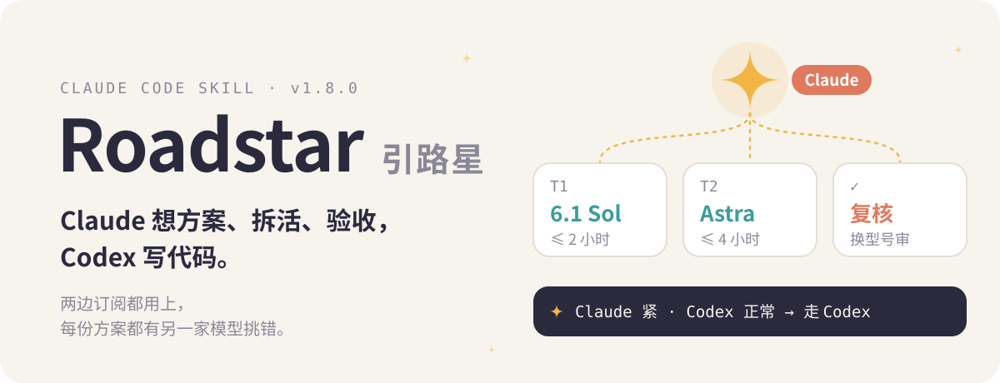

<p align="center">
  
</p>

<p align="center"><b>中文</b> · <a href="./README.en.md">English</a> · <a href="./README.ja.md">日本語</a></p>

<p align="center">
  
  
  
  
  
</p>

今天跟大家分享一个我自己做的 Claude Code 技能，叫 Roadstar，中文名引路星。我从 9 月 24 号开始做，用到现在差不多三个星期了，光是 10 月 4 号以后就在我自己的四个项目里跑了十七场，有两个 App、一个网站和一个设计工具，派出去的 Codex 会话一共两百四十四次。我个人来讲用下来是非常满意的，因为它<mark>解决了我三个非常大的问题</mark>。

<p align="center"></p>

<p align="center"></p>

首先第一个是两边订阅浪费的问题。我手里 Claude 和 GPT 两边都有订阅，但是以前基本只用 Claude，所以 Claude 的周额度经常用到一半就撞上限，GPT 那边钱照样交，额度却大部分闲着，这个多少有一点浪费。现在 Claude 只当总调度，想方案、拆活、派活、验收，真正写代码的活交给 Codex，那两百四十四次里有一百三十次是便宜的 6.1 Sol 干的，所以两边的订阅都用上了，而且 Claude 的额度全留给了它最擅长的指挥和整理。Codex 那边额度要是紧了，活就往 Claude 这边派，机械的批量活给 Haiku，规格清楚的给 Sonnet，难活才给 Opus。

再有一个是方案一次想不完的问题。同一件事让 AI 想完了，再说一句「再想想」，它总能再想出几个新的点来，而且 Claude 看不出来的问题 Codex 一看就能看出来，反过来也一样。所以 Roadstar 让两家最强的模型围着同一份方案互相挑错，每条意见都要带证据，比如哪个文件哪一行，或者一段命令的输出，Claude 一条一条处置，接受的就改，不接受的写理由，拿不准的留给我定。默认谈三轮，两边都没新问题了就提前停，所以方案交到我手里的时候，大部分坑已经被另一个模型提前踩过了。

另外一个是派活和验收太累的问题。以前一个大项目我得自己想哪块给谁，做完了还得自己一条条去验，非常的累。现在 Claude 会把项目拆成一件件两个小时之内能做完、能单独验收的小活，每件写清楚给哪个型号、做完长什么样、时间上限多少、谁来审，我只在几个关键的地方拍板，而且每一步都记在文件里，回头都能翻。

<p align="center">
  
</p>

用起来也非常的简单，在项目里对 Claude 说一句「用 skill」就可以了，它自己看现场判断走上面三种里的哪一种，开场报一行配置就开始跑，不等我答复，我想改哪项接着说一句就行。一个小时之内能干完的小活，它不走这套流程，直接做掉。

<p align="center"></p>

第一个就是额度它自己看。开场那一行会报两边额度是宽、正常、紧还是空，是一个探针一秒多读出来的，而且不花额度。大家看，这是我今天实际跑出来的结果：

```console
$ python3 skill/scripts/quota-status.py
Claude：5 小时 4%（18:49 重置）｜本周 82%（10-18 12:59 重置）｜Fable 2%（上限是周额度一半） → 紧
Codex：本周 24%（10-20 14:57 重置）｜重置卡 1 张｜credits … → 正常
```

Claude 紧、Codex 正常，所以这一周写代码的活就往 Codex 派，读到紧或者空了它一定停下来问我。模型最后拍板的永远是我，我说一句「这个月多用 GPT」，它这段时间都照着排。

另外一个是干活的和验收的一定不是同一个型号。Astra 写的让 Sol 复核，Sol 写的让 Astra 复核，或者 Claude 自己把验收命令重跑一遍；全部过了以后，Claude 还要在合并后的主干上亲自再跑一遍完整测试，Codex 自己报的<mark>「全过」只当参考</mark>。

再有一个是每条线都带止损。之前有一条做性能的线跑了七个半小时，烧掉我三成周额度，所以现在派出去就带时间上限，到点脚本直接停；同一个问题两轮没收敛，就换 Claude 这边的主模型亲自查根因。

下一个就是踩过的坑当天写成规矩，现在里面有三十一条，比如完成线必须能失败、「顺滑好看」这种词不许直接进任务书、同时跑的模拟器最多两台，每一条后面都写着是哪个项目哪一次摔出来的。还有一次合并把八百四十六个截图一起提交进了分支，一次测试全过的 App 装到手机上整屏点不动，这些现在也都成了规矩。有界面的活，设计方向它出两三版我来挑，选定以后默认打磨两遍、过两遍 review 才给我看。

<p align="center"></p>

它是按两边订阅都有来设计的，审方案和派活的两份脚本要本机装着 Codex 命令行，版本 0.160 以上。只订阅了 Claude 的朋友也能跑单家模式，审方案换成 Claude 另开一个 Opus 实例来挑错，执行走 Haiku、Sonnet、Opus，但是少了两家互相挑错那一层，而且这个模式还没有在一整场里实跑过；只订阅 GPT 的版本我还没做。另外跑一场探讨要用掉两边的额度和半小时到一小时的时间，但是因为大活返工一次的代价远比这个高，所以对我个人来讲影响不大。

总之我个人来讲，两边订阅都有、经常让 AI 干一个小时干不完的大活的朋友，这个东西非常值得试一下；平时只改改小东西的朋友，其实不用特别的着急。试的时候哪里不顺手，直接告诉我就行。OK 那，这些就是我这段时间做 Roadstar 的一些体会，希望对大家有一定的参考价值。

<p align="center"></p>

```bash
git clone https://github.com/Rurutia-Artemis/Roadstar.git
cd Roadstar && ./install.sh
```

`install.sh` 把 `skill/` 软链到 `~/.claude/skills`、`~/.agents/skills` 和 `~/.codex/skills`。在任意项目里重开一个 Claude Code 会话，说一句「用 skill」或输入 `/roadstar` 就开始。

> [!TIP]
> 最省事的装法是把这个仓库地址丢给 Claude Code，说一句「帮我装上」。

如果你是负责安装的 AI，请按下面做：

1. 克隆到一个长期保留的目录，比如 `~/Roadstar`。安装脚本链接的就是这个目录，不要克隆到临时目录，装完也不要移动或删除它。
2. 在仓库根目录跑 `./install.sh`，每个目标会打印一行「已链接」。
3. 验证：`ls -l ~/.claude/skills/roadstar` 指向仓库里的 `skill/`；`bash skill/scripts/tests/run.sh` 最后一行是 `PASS 32 checks`。
4. 查 Codex：`codex --version` 要 0.160 以上（没有就 `npm i -g @openai/codex@latest`），`codex login status` 要显示已登录。登录会打开浏览器，请让用户自己跑 `codex login`。没有 Codex 也能用单家模式。
5. 告诉用户重开一个 Claude Code 会话（技能在会话开始时加载），说一句「用 skill」或输入 `/roadstar`。

> [!IMPORTANT]
> 安装是软链，仓库文件夹删了或挪了，技能就跟着失效。

需要：Claude Code（我自己用的是 Max 套餐）；[Codex CLI](https://github.com/openai/codex) 0.160 以上，用 ChatGPT 账号登录；macOS、bash 和 Python 3，脚本只用标准库。

## 目录

```
skill/        SKILL.md、references/、scripts/（额度探针、送审、派活、桩测试）
docs/         这个技能自己每次升级的记录；在别的项目里跑的记录在那些项目的 docs/roadstar/
install.sh    把技能软链给 Claude Code 和 Codex
CHANGELOG.md  每次改动一条，写明验证了什么、没验证什么
```

## 声明

- 个人项目，与 Anthropic、OpenAI 没有关联，也没有得到它们的背书。Claude、Claude Code、Codex、ChatGPT 是各自所有者的商标。
- 它跑在你自己的订阅上，会花你的 Claude 和 Codex 额度。
- Codex 每次启动都显式指定沙箱：审稿用 `read-only`，执行用工作区可写。唯一的例外是要起模拟器的界面验收，会开全权限，并在任务书里写死边界；批准前请先看一眼任务书。
- 型号名、额度档位和价格按我 2026 年 10 月的环境写，换成你自己的请改 `skill/references/models.md`。
- 按 [MIT 许可](LICENSE) 原样提供。

---

<p align="center"><sub>README 配图按 <a href="https://github.com/oil-oil/beautify-github-readme">beautify-github-readme</a> 的做法制作。前身叫 roundtable（2026-09-24 至 10-04）。</sub></p>
