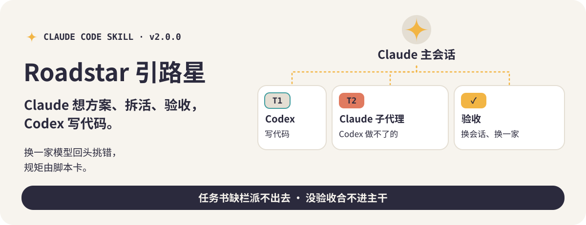
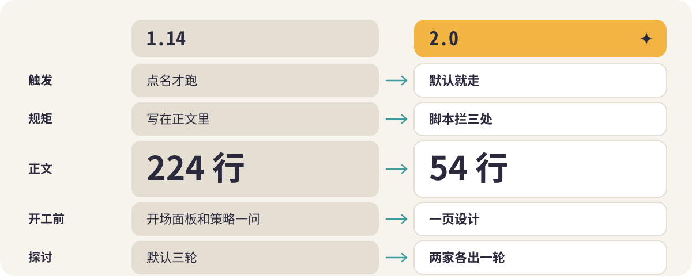
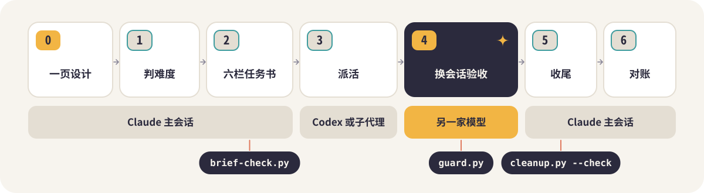
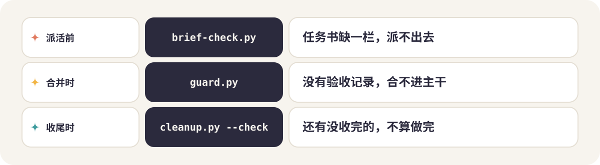
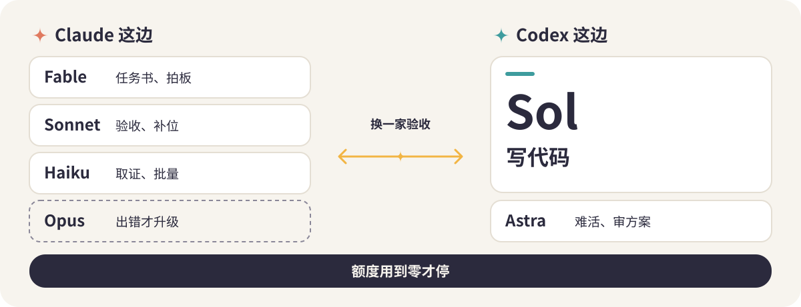

<p align="center">
  
</p>

<p align="center"><b>中文</b> · <a href="./README.en.md">English</a> · <a href="./README.ja.md">日本語</a></p>

<p align="center">
  
  
  
  
  
</p>

# Roadstar · 引路星

Roadstar 是一个 Claude Code 技能，让 Claude 主会话负责想方案、拆活和验收，把写代码的活派给 Codex，再让另一个会话、另一家模型回头挑错。一小时做不完的活，它在项目会话里自动按六步走，不用点名。

装上以后，你照常在项目里提需求。需求大过一小时，Claude 先写一页设计，再把活拆成一份份六栏任务书，派给 Codex 或 Claude 子代理去做。做完的活由换了会话、换了一家的模型复跑验收命令，查过才允许合进主干。一小时内能做完的小活它直接做掉，不走流程。

你得到的是两样东西。两边订阅的额度各管各的活，Claude 的额度留给指挥和判断；每份交付都有另一家模型的复核记录，写在仓库里，回头翻得到。

| 你要做的事 | Roadstar 怎么走 | 你得到什么 |
|---|---|---|
| 一小时内的小活 | 不走流程，Claude 直接做掉 | 一个回合交付，没有额外文件 |
| 一小时以上的中活 | 半页设计，一份任务书，一个执行方，换会话验收 | 改动加一份验收记录 |
| 要拆的大活或新项目 | 全页设计，拆成几份两小时内的任务书，先给你看派活表 | 每份各有任务书和验收记录，合进主干 |
| 只有一个构思或想复盘 | 说「开圆桌」，两家各出一轮清单，你挑 | 一份 `plan.md`，或一份挑好的不足清单 |

## 2.0 改了什么

1.14 是一个要点名才跑的长流程，正文 224 行。2.0 在 11 月 3 日重写，之后两周又靠真实项目和模拟跑补了一轮。

<p align="center"></p>

1. **默认就跑，不用记触发词。** 项目会话里凡是一小时做不完的活，自动走六步；1.14 要说「用 skill」。
2. **规矩由脚本拦，不靠模型自觉读。** 任务书缺一栏，`brief-check.py` 让 `dex-exec.sh` 退出 2，活派不出去；没有验收记录，`guard.py` 不让合并进主干；收尾时 `cleanup.py --check` 查出没收完的活，这场不算做完。
3. **正文压到两屏。** `skill/SKILL.md` 从 1.14 的 224 行、18152 字压到 54 行、4514 字，面板、策略一问、纪要、完工报告这些屏幕都收掉。1.14 全文留在 `skill/references/SKILL-v1.14.md`，随时能退回。
4. **动手前先写一页设计。** 中活写半页，大活和新项目写全页，存成场次里的 `design.md`；只有你能答的问题一次列齐，每题带推荐答案，回「好」就全按推荐走。要你点头的活，点头记录由会话钩子从你当轮的原话里取，模型手写的不算。
5. **验收换会话，还换一家，专门查有没有偷偷降标准。** Codex 写的 Sonnet 验，Sonnet 写的 Codex 验。验收记录里有「降标准五查」：下调门槛、跳过或删测试、关掉检查、留桩或半成品、新增例外，`guard.py` 合并时按文件路径核对这一节。
6. **会止损，预估会校准。** 同一检查项连败三次、空转、用掉九成时间，任一命中就停，做完的收下，只把没过的交高一级型号补全。上限是预计用时的两倍，预计用时抄经验表，`dispatch-stats.py --calibrate` 用本机实耗改写它。
7. **少拦错。** 11 月 17、18 日用真实使用记录和合成项目的模拟跑（故意做错 14 种，漏了 2 种）查出一批误拦与漏拦，收窄了五处误拦，补上两处漏拦，详情见 `CHANGELOG.md` 11 月 17、18 日两条。

## 看它拦一次

下面三段是在一次性的演示项目里真跑出来的原文，路径里的临时目录换成了 demo。第一段，任务书缺了「执行环境」一栏，`brief-check.py` 拒绝，退出码 2：

```console
$ python3 skill/scripts/brief-check.py docs/roadstar/2026-11-20-demo/rounds/exec-T1-request.md
任务书不合格，派不出去：
  - 缺「执行环境」一栏
  按 references/task-brief-template.md 补齐再派；真急可 BRIEF_CHECK=0（会记下）。
$ echo $?
2
```

第二段，演示仓库用 `install-guard.sh` 装好检查，功能分支上的提交带着 `Roadstar-Task` 尾注，却没有 `check-T1.md`，`git merge --no-ff` 被拦：

```console
$ git merge --no-ff feat/export -m "merge feat/export"
拦下了：这些任务还没有验收记录，不能合并
- docs/roadstar/2026-11-20-demo/T1：demo/docs/roadstar/2026-11-20-demo/rounds/check-T1.md
怎么办：先验收，再在上面的路径写下非空验收记录，然后重试 git merge --no-ff。
Not committing merge; use 'git commit' to complete the merge.
```

第三段，同一个场次收尾时跑 `cleanup.py --check`，活没合进主干，退出码 1：

```console
$ python3 skill/scripts/cleanup.py --project demo --check --plan-dir docs/roadstar/2026-11-20-demo
收工检查：还有 1 项没收完
没合并：T1（docs/roadstar/2026-11-20-demo）在分支 feat/export 上，1 个提交
$ echo $?
1
```

## 六步怎么走

<p align="center"></p>

文中的「主席」是你，定目标、拍板、随时插话。Argo 是 Claude 主会话，只产出任务书、裁定、派活记录和给你的几句话；Dex 是 Codex，干分给它的活、复核对方的活，不拆活也不决定。

0. 一页设计。中活半页，大活全页，要你点头的等点头再往下。
1. 判难度。小活直接干；中活一份任务书、一个执行方；大活拆成几份，每份一个目标、两小时内，列一张派活表给你看一眼。
2. 写六栏任务书：目标与做完的样子、涉及模块、不许动什么、执行环境、验收命令与期望输出、资源上限与止损。
3. 派活。规格清楚的实现给 Codex，根因不明或 Codex 做不了的给 Claude 子代理，每条线带时间上限和进度文件。
4. 验收换会话。干净会话只拿任务书、改动和测试结果，复跑验收命令，写成 `check-T<n>.md`。
5. 收尾。补齐 `.meta` 实耗，跑 `cleanup.py` 清点，提交。
6. 对账。预估和实耗的差、一次验收通过率、返工次数，反过来改预估表。

## 脚本拦在哪三处

<p align="center"></p>

第一处在派活前。`dex-exec.sh` 派活前先跑 `brief-check.py`，六栏缺一栏就退出 2。中活以上的写活还要引用设计页，需要点头的要有点头记录。

第二处在合并时。`guard.py` 通过 `skill/scripts/install-guard.sh <项目根> --claude` 装成项目的 Git 钩子，`git merge --no-ff` 时没有对应的 `check-T<n>.md` 就拦下；改了模块入口却没改 `docs/模块地图.md`，提交也会被拦。它靠提交说明里的 `Roadstar-Task:` 尾注认出这是哪件活，提交没带尾注时只提醒、不拦。

第三处在收尾时。`cleanup.py --check --plan-dir <场次目录>` 查这场还有没有没收完的活（没合并的任务、没清的副本），有就退出 1，这场不算做完。这三处脚本都在仓库里，装了就能用。

另有一道「会话结束时把没收完的活自动记成待办」的钩子，它在作者自己的环境里，仓库没有带，别人装了得不到。

## 谁干什么，型号怎么分

<p align="center"></p>

- Fable 只做主会话的任务书和拍板。
- Codex 分两档。Sol 是写代码的主力，规格清楚的实现、改动、重构先给它；Astra 做难活和审方案。
- Sonnet 做 Codex 做不了的活（联网、取证、部署后核对），验收 Codex 写的代码，Codex 额度到零时顶上写代码。
- Haiku 管只读取证和机械批量，API 价格约为 Sonnet 的二十分之一。
- Opus 只在三种情况出场：Sonnet 做错或漏了一次；两边结论对不上，Argo 看改动也判不了；Codex 到零，而这件活出错代价大。升级时要写一句为什么。

分工表在 `skill/references/dispatch-table.md`。具体的型号 ID 和价格写在 `skill/references/models.md`，出了新型号只改那一个文件。

额度用到零才停。到零告诉你一次，由你充值或重置，之前不停派、不问。`skill/scripts/quota-status.py` 不花额度，随时能读两边现在用了多少。

只订阅一家的情况分开说。只有 Claude 订阅可以跑单家模式：分工表每行只剩 Claude 一格，审方案由 Fable 子代理担任，并明说「本场单家模式，审稿同家」，审查人仍和执行方型号不同，只是少了跨家挑错这一层。只有 GPT 订阅用不了，主会话 Argo 必须是 Claude。

## 用起来的样子

每件活在项目里占一个目录 `docs/roadstar/<日期>-<slug>/`，另有一份常驻边界 `docs/roadstar/_common.md`。

```text
docs/roadstar/2026-11-20-export-button/
  design.md                    一页设计（中活起必写）
  plan.md                      大活才有
  ledger.md                    裁决、争议、调度记录
  rounds/
    exec-T1-request.md         任务书
    exec-T1.md                 执行方的交回
    exec-T1.meta               型号、强度、预估和实耗
    exec-T1.progress           每试一次检查项记一行
    check-T1.md                换会话验收的记录
```

任务书按 `skill/references/task-brief-template.md` 写，下面是第一栏的骨架，尖括号是要填的内容。

```markdown
# T1 · <一句人话任务名>
设计页：docs/roadstar/<日期>-<slug>/design.md

## 目标与做完的样子
<一个目标。完成线拆成 C1 … Cn，每项一条能失败的数字或可观测条件，附测法>
```

其余五栏是涉及模块、不许动什么、执行环境、验收命令与期望输出、资源上限与止损。写不出的栏写「待定：缺什么信息」，有待定项的任务书不派。

## 开圆桌

你只有一个构思，或想复盘一个已有项目时，说「开圆桌」「探讨」「复盘」或「全面 review」。探讨时 Argo 和 Dex 各出一轮短清单，写副功能、设置、衍生功能和工程风险，你挑，再写 `plan.md`；复盘时两家各只读一遍项目、各出一份不足清单，Argo 合并，你选哪几件进第 1 步。细节在 `skill/references/modes.md`。

## 安装和要求

```bash
git clone https://github.com/Rurutia-Artemis/Roadstar.git
cd Roadstar && ./install.sh
```

`install.sh` 把 `skill/` 软链到 `~/.claude/skills/roadstar`、`~/.agents/skills/roadstar` 和 `~/.codex/skills/roadstar`，并清掉前身 roundtable 的旧软链。装完重开一个 Claude Code 会话，在项目里提一件大于一小时的活就会按流程走，也可以输入 `/roadstar`。

> [!TIP]
> 最省事的装法是把这个仓库地址丢给 Claude Code，说一句「帮我装上」。

如果你是负责安装的 AI，请按下面做：

1. 克隆到一个长期保留的目录，比如 `~/Roadstar`，软链指向这里，装完不要移动或删除。
2. 在仓库根目录跑 `./install.sh`，每个目标会打印一行「已链接」。
3. 验证：`ls -l ~/.claude/skills/roadstar` 指向仓库里的 `skill/`；`bash skill/scripts/tests/run.sh` 退出码为 0。
4. 查 Codex：`codex --version` 要 0.160 以上（没有就 `npm i -g @openai/codex@latest`），`codex login status` 要显示已登录；登录会开浏览器，请让用户自己跑 `codex login`。没有 Codex 走单家模式。
5. 给某个项目装合并和提交检查：`skill/scripts/install-guard.sh <项目根> --claude`，然后告诉用户重开 Claude Code 会话。

需要 Claude Code；要走双家流程还需要 [Codex CLI](https://github.com/openai/codex) 0.160 以上并用 ChatGPT 账号登录；macOS、bash 和 Python 3，脚本只用标准库。

> [!IMPORTANT]
> 安装是软链，仓库文件夹删了或挪了，技能就跟着失效。点头记录由作者自己环境里的钩子工具写，这个仓库没有带它。别的环境里，要点头的活在 `brief-check.py` 这一关会因缺记录被拦，需要设 `ROADSTAR_DESIGN_CHECK=0` 跳过设计页检查（会记账）。

## 目录

`skill/` 放 `SKILL.md`、`references/`（模板、分工表、型号表）和 `scripts/`（检查、派活、额度探针、桩测试）；`docs/` 放这个技能自己的场次记录、模块地图和数据回传说明；`install.sh` 做软链；`CHANGELOG.md` 每次改动一条，写明验证了什么、没验证什么。

## 数据回传（自愿，默认关）

`skill/scripts/telemetry.py` 还在，默认处于关闭状态，只有你跑 `python3 skill/scripts/telemetry.py enable` 才开。开了以后，每场结束用你本机的 `gh` 在公开仓库 [roadstar-data](https://github.com/Rurutia-Artemis/roadstar-data) 以你的 GitHub 账号开一条 Issue，内容是 12 个固定字段（活的类别、型号、强度、做没做完、用时、额度差等），没有代码、路径、项目名和任何自由文字。发送前会在本机留一份原文。`telemetry.py disable` 或设 `ROADSTAR_TELEMETRY=0` 即关，`status` 看现状。字段清单和格式见 `docs/社区数据回传.md`。

## 声明

- 个人项目，与 Anthropic、OpenAI 没有关联，也没有得到它们的背书。Claude、Claude Code、Codex、ChatGPT 是各自所有者的商标。
- 它跑在你自己的订阅上，会花你的 Claude 和 Codex 额度。
- 默认不加 `--dangerously-*`；Codex 复核用 `read-only`，执行用工作区可写。要起模拟器、开端口的验收才开 `danger-full-access`，边界写死在任务书里，批准前请看一眼。
- 按 [MIT 许可](LICENSE) 原样提供。

---

<p align="center"><sub>README 配图按 <a href="https://github.com/oil-oil/beautify-github-readme">beautify-github-readme</a> 的做法制作。前身叫 roundtable（2026-09-24 至 10-04）。</sub></p>
